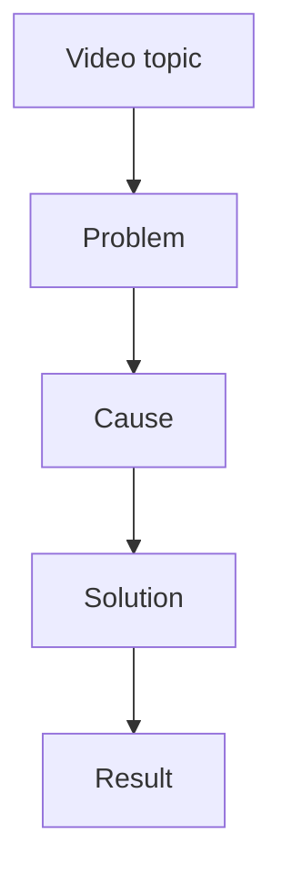

# YouTube To Article

## Overview

Convert a YouTube video into a source-faithful but standalone Markdown article by first obtaining the transcript, then cleaning and analyzing it, then reconstructing the ideas into a coherent article with Mermaid diagrams where diagrams improve clarity.

Always preserve the video's factual content. Do not invent facts, examples, numbers, speaker claims, or citations that are not present in the transcript or independently verified sources.

Do not merely translate or lightly polish the transcript. The final article should preserve the video's central thesis while improving structure, depth, breadth, logic, and reader value.

The article body should not reveal that it was derived from a video unless the user explicitly asks for a source-aware article. It is acceptable to keep a compact source metadata note near the top of the Markdown output.

## Workflow

1. Parse the input YouTube URL or video ID.
2. Collect metadata when available: title, channel, publish date, duration, original URL.
3. Obtain content in this order:
   - Existing human subtitles or transcript.
   - Auto-generated YouTube subtitles.
   - Audio transcription only when subtitles are unavailable and the user approves any needed download/transcription step.
4. Save intermediate transcript files only in the temporary run directory described in Storage And Cleanup.
5. Clean the transcript:
   - Remove timestamps, cue numbers, WebVTT headers, music markers, and repeated boilerplate.
   - Merge broken subtitle lines into readable sentences.
   - Keep speaker labels when meaningful.
   - Preserve terms, names, dates, numbers, and named frameworks.
   - Count the cleaned source information's Chinese characters before drafting.
6. Analyze before drafting:
   - Identify the central thesis, target reader, key claims, supporting examples, causal chain, and conclusion.
   - Separate core ideas from delivery artifacts such as jokes, repetition, transitions, sponsorship, and filler.
   - Notice implications, trade-offs, limitations, and adjacent concepts that help readers understand the topic.
   - Identify ideas that are better explained with diagrams or tables before drafting prose.
7. Reconstruct the article:
   - Build an outline that serves the reader, not necessarily the video's timeline.
   - Preserve the video's center, but reorganize sections when a different order makes the argument clearer.
   - Add reasoned synthesis and connective analysis derived from the transcript.
   - Plan diagram/table placements as part of the outline, not as decoration after the prose is done.
8. Draft the Markdown article according to the output standard below.
9. Verify the article body length against the dynamic length rule in Markdown Article Standard.
10. Run a final source-faithfulness pass against the transcript.
11. Clean up temporary files after the final Markdown article is written, following the downloaded-video rule in Storage And Cleanup.

## Storage And Cleanup

Use this default file policy unless the user specifies another location:

- Create a per-video temporary run directory under `/private/tmp/youtube-to-article/<video-id>-<timestamp>/`.
- Put downloaded subtitles, raw WebVTT/SRT files, extracted audio, downloaded video, tool logs, and cleaned transcript drafts in that temporary run directory.
- Write the final `.md` article to the current workspace directory or the user-requested output path.
- After a successful final article is produced, delete temporary subtitle, audio, transcript draft, and log files automatically unless the user asks to keep them.
- If a full video file was downloaded, do not delete it automatically. Before deleting it, tell the user the video file path, file size, and video clarity/resolution, then ask whether to delete it.
- If the user chooses to keep the downloaded video, move it to the user's `~/Downloads` directory and report the final path in the final response.
- If the user chooses to delete the downloaded video, delete it and then remove the temporary run directory if no requested artifacts remain.
- If the workflow fails before producing the article, keep the temporary run directory and report its path so the user can inspect or reuse partial results.
- If the user asks to preserve evidence, reproducibility artifacts, or the transcript, copy only the requested files next to the final article before deleting the rest.

Avoid downloading full video when subtitles or audio-only transcription is enough. Prefer subtitle-only retrieval, then audio-only retrieval, and use full video download only when explicitly necessary.

When asking about downloaded video deletion, use this shape:

```text
The full video was downloaded to generate the article:
- Path: ...
- Size: ...
- Quality: ... (for example, 1920x1080 / 1080p; say unknown if it cannot be detected)

Do you want to delete this downloaded video file?
```

If the user answers no or asks to keep the video, move the video to `~/Downloads`. If a file with the same name already exists, append a short unique suffix before the extension instead of overwriting it.

## Helper Script

Use `scripts/yt_article_helper.py` for deterministic URL parsing and transcript cleanup:

```bash
python3 /path/to/youtube-to-article/scripts/yt_article_helper.py parse-url "https://www.youtube.com/watch?v=VIDEO_ID"
python3 /path/to/youtube-to-article/scripts/yt_article_helper.py clean-transcript raw.vtt --output cleaned.txt
python3 /path/to/youtube-to-article/scripts/yt_article_helper.py count-source cleaned.txt
python3 /path/to/youtube-to-article/scripts/yt_article_helper.py count-article-body article.md
python3 /path/to/youtube-to-article/scripts/yt_article_helper.py media-info downloaded-video.mp4
```

If `yt-dlp` is available, a useful subtitle extraction command is:

```bash
yt-dlp --skip-download --write-subs --write-auto-subs --sub-langs "zh-Hans,zh-Hant,zh,en.*" --sub-format vtt "YOUTUBE_URL"
```

Network access, YouTube access, or third-party tools may require user approval in restricted environments. If transcript retrieval is blocked, ask the user to provide subtitles/transcript text and continue from the cleaning step.

## Markdown Article Standard

Output the final document as Markdown only unless the user asks for another format.

The article must read like an intentionally written article, not a transcript translation, subtitle cleanup, or chronological recap.

Default length requirement:

- For Chinese articles, the main body must contain more than 8000 Chinese characters.
- If the cleaned source information extracted from the video contains more than 8000 Chinese characters, the main body must contain at least `ceil(cleaned_source_chinese_chars * 1.4)` Chinese characters.
- The effective Chinese length target is therefore:
  - `8001` Chinese characters when `cleaned_source_chinese_chars <= 8000`.
  - `ceil(cleaned_source_chinese_chars * 1.4)` Chinese characters when `cleaned_source_chinese_chars > 8000`.
- Define `cleaned_source_chinese_chars` as the count of Chinese characters in the cleaned transcript/source-information file after removing timestamps, cue numbers, WebVTT/SRT boilerplate, repeated lines, music markers, sponsorship chatter, and other non-informational delivery artifacts where possible.
- Count only prose body content. Do not count the title, source note, summary, table of contents, headings, code blocks, Mermaid diagrams, Markdown tables, bullet-only takeaway lists, or metadata.
- Mermaid diagrams and Markdown tables do not count toward the prose length target, but the length target must never reduce or discourage diagram/table use.
- If the article is below the required length, expand the body with deeper analysis, clearer causal reasoning, richer comparisons, practical implications, caveats, and smoother transitions while preserving the source's central meaning. Do not replace useful diagrams or tables with prose merely to satisfy the word count.

Required structure:

```markdown
# Title

> Source: YouTube video title/channel/date when known.

> Summary: A standalone article summary of 200 Chinese characters or fewer. For non-Chinese articles, keep it to 120 words or fewer.

## Introduction

## Main Point 1

## Main Point 2

## Main Point 3

## Key Takeaways

## Conclusion
```

Adapt section names to the subject. Use 3-7 body sections for most articles. For long articles, include a `## Table of Contents` after the source and summary notes.

Writing requirements:

- Write as a coherent article, not a bullet-only summary.
- Add a concise summary immediately below the title. In Chinese output, keep this summary within 200 Chinese characters.
- Reconstruct the argument around a clear thesis, readable narrative arc, and useful section hierarchy.
- Prefer diagram-first or table-first explanation when a process, hierarchy, comparison, lifecycle, decision path, system architecture, concept map, timeline, or cause-effect chain would be clearer visually.
- Pair important diagrams/tables with surrounding prose that explains how to read them and what conclusion they support.
- Ensure the prose flows naturally: each paragraph should connect to the previous one, transitions should explain why the next idea follows, and the reader should never feel they are jumping between disconnected notes.
- Make the logic explicit: define the problem, explain causes, show evidence, analyze implications, address caveats, and close with a conclusion that follows from the body.
- Prefer conceptual grouping over strict video chronology when it improves understanding.
- Add depth by explaining why the ideas matter, what assumptions they depend on, what trade-offs they imply, and where their limits are.
- Add breadth by connecting related concepts, comparing adjacent approaches, and naming practical implications, as long as these connections are supported by the transcript or clearly framed as analysis.
- Distinguish between video-supported claims and your own synthesis. Do not present inference as transcript fact.
- Remove filler, repeated phrases, sponsorship chatter, and off-topic digressions unless important to the user's goal.
- Keep core arguments, examples, sequence, and conclusions.
- Mark uncertainty explicitly when the transcript is unclear.
- Use concise paragraphs and descriptive headings.
- Include original terminology in parentheses when translating important concepts.
- Do not include timestamps unless the user asks for chapter notes or source traceability.
- Keep source metadata separate from the article body. A top-level `Source` note is allowed, but the title, summary, headings, body prose, diagrams, and takeaways should read as a standalone article.
- Avoid provenance phrasing in the article body, such as "this video", "the video says", "based on the video", "the transcript shows", "subtitle", "YouTube", "source video", "video summary", or "one-sentence video summary".
- Use external research only when the user requests it or when verification is necessary. Cite external sources when used.

Avoid:

- Section-by-section paraphrases that mirror the video too closely.
- Any body wording that makes the article feel like it was converted from a video, transcript, subtitle file, or content summary.
- Over-expanding beyond the video's center.
- Inflated claims, invented examples, fake citations, or unsupported statistics.
- Generic "AI will change everything" filler unless the video actually makes that point.

## Mermaid Diagrams

Use Mermaid diagrams when they make relationships, processes, timelines, hierarchies, decision paths, system roles, or comparison logic clearer. Prefer diagrams over prose-only explanation for inherently structural content.

Diagram/table priority:

- During outline planning, explicitly decide which sections need diagrams or tables.
- For concept stacks, pipelines, workflows, system interactions, dependency chains, lifecycle stages, evaluation loops, and role boundaries, include a Mermaid diagram unless it would be misleading or redundant.
- For dense comparisons, trade-offs, definitions, input/output mappings, or checklists, use a Markdown table when it is clearer than prose.
- Do not remove or avoid diagrams/tables because they do not count toward the Chinese prose length target.
- Do not pad prose to replace a useful diagram. Satisfy length requirements by adding analysis around, before, and after the diagram.

Rules:

- Use fenced `mermaid` code blocks.
- Prefer `flowchart TD` for processes, `sequenceDiagram` for interactions, `timeline` for historical sequences, and `mindmap` for concept maps.
- Keep node text short and quote labels that contain punctuation.
- Do not create diagrams for decoration. Every diagram must summarize real content from the transcript.
- If Mermaid cannot represent the idea cleanly, use a Markdown table instead.
- Every diagram or table should be introduced by prose and followed by explanatory prose unless it is part of a compact reference section.

Example:



## Quality Checklist

Before final output, verify:

- The article is Markdown and renders without broken heading hierarchy.
- Mermaid blocks are syntactically plausible and contain only transcript-supported claims.
- The article considered diagram/table opportunities before drafting and used them where they improve clarity.
- Diagram/table use was not reduced to satisfy the prose length target.
- Claims, numbers, names, and examples match the transcript.
- The article has a clear thesis, introduction, structured body, takeaways, and conclusion.
- The article begins with a summary that stays within the requested length limit.
- The article is meaningfully reconstructed rather than simply translated or summarized in video order.
- Added analysis improves understanding without changing the video's central meaning.
- The prose reads smoothly, with natural transitions and no abrupt jumps between sections.
- The logic is easy to follow from problem to evidence to analysis to conclusion.
- Source metadata, if present, is separated from the article body.
- The article body is standalone and does not expose video/transcript/subtitle provenance unless explicitly requested.
- The cleaned source information's Chinese character count was measured and used to calculate the effective target.
- The Chinese prose body exceeds 8000 Chinese characters when the cleaned source information is 8000 Chinese characters or fewer.
- When the cleaned source information is more than 8000 Chinese characters, the Chinese prose body is at least 1.4x the cleaned source information's Chinese character count.
- Article body counts exclude title, source, summary, table of contents, headings, code, Mermaid diagrams, tables, bullet-only lists, and metadata.
- No fabricated citations or unsupported outside context were added.
