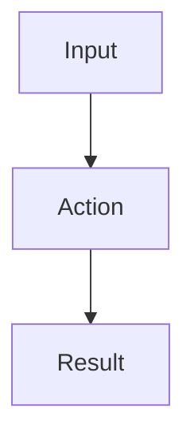
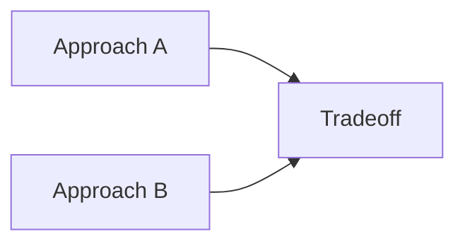
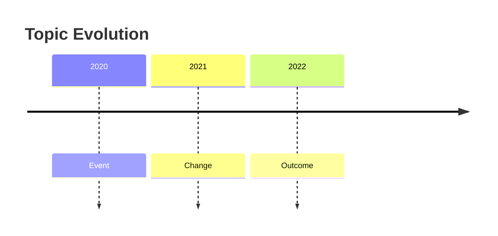

# Article Output Reference

Use this reference when the user asks for stricter article formatting or higher-quality synthesis.

## Reconstruction Principles

The article should preserve the video's center while improving the reader's experience. Treat the transcript as source material, not as the article outline, and write the final piece as a standalone article.

Before writing, infer:

- Central thesis: the one-sentence claim the article should defend.
- Reader promise: what the reader will understand after reading.
- Argument path: the order that best teaches the idea.
- Evidence map: examples, data, stories, and named sources from the video.
- Analysis layer: implications, trade-offs, limits, comparisons, and practical lessons.
- Visual map: sections where diagrams or tables would explain structure, process, comparison, lifecycle, or causality better than prose alone.

Good reconstruction may:

- Move background earlier than the video if it helps comprehension.
- Merge repeated segments into one sharper section.
- Split a dense segment into multiple conceptual sections.
- Add Mermaid diagrams for structural ideas before expanding prose.
- Add Markdown tables for dense comparisons, trade-offs, definitions, mappings, or checklists.
- Add transition paragraphs that explain why one idea leads to the next.
- Turn loose commentary into a clear claim, reason, implication, and caveat.
- Maintain a smooth reading experience: every section should answer the question raised by the previous one or clearly open the next layer of the argument.

Do not add unsupported facts. If adding outside context, label it clearly and cite sources when available.

Do not expose provenance in the article body by default. A compact source metadata note is allowed near the top, but the title, summary, headings, body prose, diagrams, and takeaways should read as a standalone article. Avoid body wording such as "this video", "the video explains", "based on the transcript", "subtitle", "YouTube", "video summary", or "one-sentence video summary" unless the user explicitly asks for a source-aware article.

## Default Markdown Shape

```markdown
# Clear Article Title

> Source: Video title, channel, publish date, URL.

> Summary: A standalone summary of 200 Chinese characters or fewer. For non-Chinese articles, use 120 words or fewer.

## Introduction

One or two paragraphs stating the core problem, central thesis, and reader promise.

## Context

Background needed to understand the video.

## Core Thesis

The main claim reconstructed as article prose.

## How It Works

Use a Mermaid flowchart when the video explains a process.

## Why It Matters

Explain implications, trade-offs, and practical consequences.

## Key Evidence And Examples

Retain concrete examples from the video.

## Limits Or Open Questions

Name uncertainty, controversy, or boundaries of the video's argument when relevant.

## Key Takeaways

- Takeaway 1
- Takeaway 2
- Takeaway 3

## Conclusion

Close with the video's conclusion or a faithful synthesis.
```

## Quality Rubric

A strong article should score well on:

- Fidelity: The center, claims, examples, and numbers match the source.
- Reconstruction: The structure is optimized for reading, not copied from the video timeline.
- Length: For Chinese output, the prose body contains more than 8000 Chinese characters when the cleaned source information is 8000 Chinese characters or fewer. If the cleaned source information contains more than 8000 Chinese characters, the prose body contains at least 1.4x the cleaned source information's Chinese character count. Counts exclude title, source, summary, table of contents, headings, code blocks, Mermaid diagrams, tables, and bullet-only lists.
- Visual clarity: Diagrams and tables are used whenever they make processes, hierarchies, comparisons, timelines, decision paths, system interactions, or causal chains clearer. The prose length requirement must not reduce diagram/table usage.
- Summary: The article opens with a concise summary within the requested length limit.
- Standalone quality: The article body does not read like it came from a video, transcript, or subtitle source.
- Depth: The article explains causes, assumptions, implications, and limits.
- Breadth: The article connects adjacent concepts without drifting away from the source.
- Clarity: Headings are descriptive, paragraphs are concise, and transitions are explicit.
- Flow: The prose feels natural, connected, and article-like rather than stitched together from notes.
- Logic: The argument moves cleanly from problem to context to evidence to analysis to conclusion.
- Usefulness: A reader can act on or remember the framework after reading.

## Mermaid Patterns

Use visual structures as first-class explanation tools, not decorative extras. Introduce each substantial diagram/table with prose, then explain the takeaway after it.

Process:



Comparison:



Timeline:


